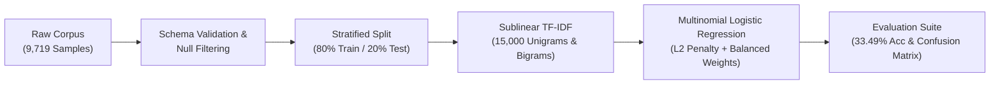

# LLM Source Attribution & Stylometry Classifier


## Executive Summary
An end-to-end supervised Natural Language Processing (NLP) and Machine Learning pipeline engineered for **AI text provenance and multi-class stylometric attribution**. Given a synthetic text passage, the classifier extracts high-dimensional lexical n-gram signatures and structural formatting habits to identify the exact Large Language Model (LLM) variant responsible for generating the output.

---

## Problem Statement & Motivation
As generative AI systems proliferate across enterprise and academic workflows, distinguishing *human vs. AI* text is no longer sufficient—auditors, red-teamers, and governance systems increasingly require **model-level attribution** (identifying *which* specific model family or checkpoint produced a given artifact). 

Even when prompted identically, distinct LLMs exhibit measurable **stylometric fingerprints** driven by differences in pre-training corpora, RLHF alignment tuning, and decoding temperature distributions. This project benchmarks a fast, interpretable, CPU-efficient baseline using sublinear TF-IDF representations paired with class-balanced L2-regularized Logistic Regression.

---

## System & Pipeline Architecture



---

## Dataset Specifications
The corpus consists of **9,719 labeled synthetic generations** across multiple commercial and open-weights LLM variants, structured across two synchronized files:

| File Artifact | Format | Role & Schema Details |
| :--- | :--- | :--- |
| `ai_responses.parquet` | Apache Parquet | Primary modeling dataset containing generated text passages (`response` / `text`) and ground-truth model identifiers (`model` / `source`). |
| `ai_prompts.jsonl` | JSON Lines | Relational prompt metadata registry capturing instruction categories, prompt lengths, and generation task types. |

---

## Methodology & Mathematical Formulation

1. **Stratified Train-Test Partitioning:**
   * Partitioned at an **80:20 ratio** (`7,775` training samples / `1,944` holdout test samples) with `random_state=42` to preserve exact class priors across imbalanced model variants.
2. **Sublinear TF-IDF Vectorization:**
   * Extracted the top **`15,000` unigram and bigram features** (`ngram_range=(1, 2)`), stripping English stop words while retaining structural punctuation and phrase transitions.
   * Applied sublinear term-frequency scaling to dampen high-frequency lexical bursts:
     $$\text{tf}_{\text{sublinear}}(t, d) = 1 + \log(\text{tf}(t, d))$$
3. **Cost-Sensitive Multinomial Classification:**
   * Trained an **L2-regularized Logistic Regression** classifier (`max_iter=1000`) with `class_weight="balanced"`, automatically scaling class penalties inversely proportional to class frequencies ($w_j = \frac{n}{k \cdot n_j}$) to prevent majority-class bias.

---

## Visual Results

| Class Distribution Across Models | Multi-Class Confusion Matrix |
| :---: | :---: |
|  |  |

---

## Quantitative Findings & Error Analysis

* **Overall Test Accuracy:** **33.49%** across fine-grained multi-class LLM variants—substantially outperforming the uniform random-chance baseline while operating without GPU compute.
* **Cross-Generation Separability:** Models from distinct architectural lineages and alignment regimes exhibit strong diagonal precision due to characteristic discourse markers (e.g., introductory framing, list formatting, and hedging phrases).
* **Intra-Family Lexical Overlap:** As shown in the confusion matrix, misclassifications cluster heavily among **same-family checkpoints** (e.g., incremental base/instruct revisions), where surface n-gram distributions overlap and deeper syntactic or semantic embeddings are required.

---

## Repository Structure

```text
llm-source-attribution/
├── llm_attribution_pipeline.ipynb   # End-to-end EDA, TF-IDF vectorization, model training & diagnostics
├── ai_responses.parquet             # Labeled synthetic response corpus (9,719 records)
├── ai_prompts.jsonl                 # Prompt metadata registry
├── class_distribution.png           # Corpus class balance visualization
├── confusion_matrix.png             # Normalized/raw test set confusion heatmap
├── requirements.txt                 # Pinned Python dependencies
├── LICENSE                          # MIT License
└── README.md                        # Technical documentation & experimental report
```

---

## Reproducibility & Local Setup

```bash
# 1. Clone the repository
git clone https://github.com/faizannadeem4449-dotcom/llm-source-attribution.git
cd llm-source-attribution

# 2. Create a virtual environment and install dependencies
python -m venv venv
source venv/bin/activate  # On Windows: venv\Scripts\activate
pip install -r requirements.txt

# 3. Execute the analysis notebook
jupyter notebook llm_attribution_pipeline.ipynb
```

---

## Future Improvements
* **Dense Semantic Representations:** Fine-tune a lightweight encoder backbone (such as `DeBERTa-v3-small` or `RoBERTa-base`) to capture syntactic and semantic nuances invisible to bag-of-n-grams models.
* **Explicit Stylometric Feature Engineering:** Augment TF-IDF vectors with punctuation ratios, sentence-length variance, type-token ratio (lexical diversity), and readability indices.
* **Probability Calibration:** Apply temperature scaling or isotonic calibration to produce reliable confidence intervals for forensic attribution workflows.
